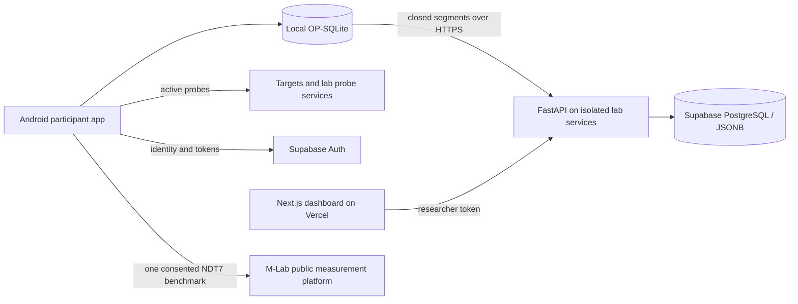

# SkyMeasure

SkyMeasure is an Android research pilot for crowdsourced in-flight network measurements on unrooted phones. The participant app uses React Native and TypeScript; an authenticated FastAPI service stores research evidence in Supabase PostgreSQL, and a Next.js dashboard lets approved researchers inspect and export it. Android ships first; iOS device and background behavior are not validated.

**Review this branch:** [feature/skymeasure-participant-dashboard](https://github.com/HailemariamMersha/capstone/tree/feature/skymeasure-participant-dashboard). The repository's `main` branch contains an earlier collector. The repository is public; access to the [research dashboard](https://capstone-backend-henna.vercel.app/) still requires a researcher role.

**Joining the work?** Follow [CONTRIBUTING.md](CONTRIBUTING.md) for the correct branch, local setup without cloud credentials, tests, Android builds and the contribution workflow. The [architecture/source map](docs/architecture.md) shows where each part lives.

## Participant and researcher flow

Participants review the study and M-Lab publication disclosure, enter required flight number, route and expected length, and tap **Start trip**. Supabase anonymous authentication supplies a pseudonymous installation identity without an email/password screen. There are no Google/researcher controls on the phone; existing identities retain ownership and only the researcher website uses Google sign-in. Records save to account-owned OP-SQLite before upload. Identity reset never reassigns old records.

The current detector, **`asn-only-v1`**, qualifies selected Wi-Fi using two fresh matching provider-ASN evaluations at least thirty seconds apart. GPS and airline SSIDs do not qualify it; automatic trips do not sample GPS. A provider match can occur on the ground and **does not prove that a phone is airborne**. Unknown lookups cannot initially qualify; outages on the same previously qualified Wi-Fi retain probe evidence. A fresh nonmatching ASN pauses collection. The private pilot additionally accepts AS12 as TEST New York University through this same detector; those trips are permanently labelled ground tests and excluded from flight totals by default. Non-pilot builds retain the six-provider list. See the [current collection policy](docs/measurements/flight-collection.md).

One continuous trip contains closed fifteen-minute segments. Upload pauses retain trip budgets and detector state. The dashboard groups received segments, displays missing/reconciled evidence and dynamic measurement summaries, and offers filters, variable explanations, raw JSON and combined measurement/sample CSV. A received segment reports the phone's last state, not whether it is currently online.



The API and UDP service run in isolated services on a shared lab server. Its region is `lab-location-unconfirmed`; the DigitalOcean host is retained for rollback. Do not label an unknown host location London or Frankfurt.

## Measurements and implementation

| Measurement | Current implementation | Interpretation |
| --- | --- | --- |
| ICMP RTT, jitter and loss | `icmpenguin` through a thin Android adapter | Individual library probe responses; not full packet capture |
| Traceroute | `icmpenguin`, twenty-hop default | Per-hop probe evidence; library response labels have documented limitations |
| TCP connection duration | `react-native-tcp-socket` | Connection callback duration; no custom kernel `TCP_INFO` collection |
| UDP echo RTT, jitter and loss | `react-native-udp` with bounded controlled echo server | Per-probe application datagrams; timeout does not prove a library limitation |
| Controlled download/upload | `@dr.pogodin/react-native-fs` streaming downloads; React Native `fetch` uploads | Known payload and elapsed time; not an Ookla-equivalent capacity test |
| M-Lab NDT7 benchmark | Pinned patched `ndt7-client-android` library | One automatic pair per trip, publication consent required; capped/partial results are not valid completed speeds |
| Network and device context | NetInfo, device-info, server GeoLite2-ASN, cached PTR, Android Wi-Fi binding adapter | Availability varies; context is not a fresh reading per packet |

Automatic trips schedule minute-level ICMP/UDP/TCP, fifteen-minute traceroutes, spaced controlled transfers and one M-Lab pair. HTTP RTT and loaded-latency implementations remain available in collector tooling; loaded-latency tests are off in automatic trips. [Scheduling and health](docs/skymeasure/collector-reliability.md) explains deadlines, gaps, failures and cancellations. Dedicated measurement-block scheduling is a proposal, not an implemented feature.

The private 1.2.0 pilot allows normal-duration M-Lab testing without a byte cutoff or 200 MiB reservation. It has no overall 300 MiB ceiling: M-Lab is separate from 60 MiB controlled transfers, 20 MiB diagnostics/context and 20 MiB live uploads. Older bounded policies remain readable. See the [current uncapped pilot policy](docs/skymeasure/uncapped-pilot.md). It excludes unobservable transport overhead and additional post-trip synchronization. The [M-Lab guide](docs/skymeasure/automatic-mlab.md) explains caps, formulas and public-data disclosure.

React Native Paper/Navigation provide the UI, Keychain stores tokens, background-actions runs the visible foreground task, and background-fetch offers opportunistic closed-session retries. Custom Android code selects/binds Wi-Fi and exposes library results; it is distinct from an application-owned packet engine. The historical custom engine is preserved on `experiment/custom-packet-engine`; see the [library/native comparison](docs/library-packet-comparison.md). Exact dependency versions are pinned in package manifests and the Android NDT7 source.

## Run and review

Use Node 22.13+ (including Node SQLite support) for shared-code checks. Android builds additionally need the React Native Android toolchain; physical checks need a USB-debugging phone. Contributors can run collector, backend and dashboard tests without live research credentials; see [the contributor guide](CONTRIBUTING.md).

```sh
npm ci
npm run typecheck
npm test -- --runInBand --watchman=false
```

For a configured pilot APK, copy `.env.skymeasure.example` to `.env.skymeasure.local` and supply **public application configuration only**, then run:

```sh
npm run android:pilot
```

The builder reads the local file, uses private pilot configuration and its retained enrollment callback, verifies configuration inside the APK and restores the sanitized tracked configuration. Outputs and the build manifest are under `build/pilot/current/`. The APK currently uses the standard development signing key; use it for supervised testing, not a public production release. Share the APK; JSON exports and build manifests are researcher evidence, not install dependencies. `npm start` and `npm run android` support development with separately configured public settings; never commit those local settings.

Backend setup and validation:

```sh
python3 -m venv backend/.venv
backend/.venv/bin/python -m pip install -r backend/requirements.txt
backend/.venv/bin/python -m pytest backend/tests -q
```

Configure server-only environment inputs using [the setup guide](docs/skymeasure/setup.md). Run locally with `backend/.venv/bin/python -m uvicorn backend.app:app --host 127.0.0.1 --port 8000`. Legacy shared-token ingestion is restricted to explicit local development mode; staging uses authenticated `/api/v2` ownership and researcher authorization.

Dashboard:

```sh
npm ci --prefix dashboard
# Copy dashboard/.env.example to dashboard/.env.local and configure public endpoints.
npm run dev --prefix dashboard
npm run typecheck --prefix dashboard
npm test --prefix dashboard
```

Offline analysis of an existing complete session JSON (original exports remain unchanged):

```sh
npm run measurements:analyze -- --input /path/to/session.json --out /path/to/new-analysis
```

Start with the [measurement guide](docs/measurements/guide.md), [column dictionary](docs/measurements/columns.md) and [combined CSV guide](docs/skymeasure/combined-csv.md). Blank values mean unavailable or inapplicable, not zero. Parent values repeated across sample rows must not be summed repeatedly. Regenerate shared documentation with `npm run measurements:docs` and `npm run skymeasure:docs`.

## Repository map and validation status

| Path | Contents |
| --- | --- |
| `src/`, `App.tsx` | Participant UI, authentication, trip runtime, collector, storage and sync |
| `android/`, `ios/` | Platform projects; Android adapters and NDT7 integration; iOS scaffold |
| `backend/` | FastAPI probes, UDP service, ingestion, authorization, research queries and exports |
| `dashboard/` | Researcher workspace and browser tests |
| `scripts/`, `patches/` | Build/configuration tools, analysis dictionary and owned dependency patches |
| `__tests__/`, `backend/tests/` | Collector, privacy, ownership, upload and analysis tests |
| `deploy/` | Deployment templates and isolated lab-service tooling |
| `docs/` | [Reading map](docs/README.md), current policies and dated experiment evidence |

Automated checks and dated physical ground tests support implementation behavior. They do not establish airborne detection accuracy, captive-Wi-Fi routing for every protocol, unplugged endurance across manufacturers, or iOS support. Public recruitment still requires protected enrollment, approved study text and completed identity-deletion operations. See [validation](docs/skymeasure/validation.md) and dated [experiment records](docs/experiments/).

Private runtime configuration, raw participant datasets, generated APKs and local presentation outputs stay outside source control. See [SECURITY.md](SECURITY.md) before sharing logs or evidence. Historical documents preserve prior policies and custom-engine experiments; the current policy and dependency manifests take precedence for new builds.
