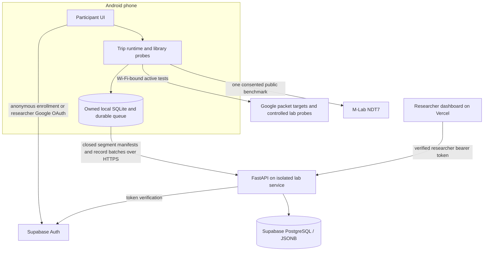

# Current architecture and code map

Current detector: `asn-only-v1`; trip budget policy: `flight-mlab-2026-11-02`; collector scheduling policy: `collector-scheduler-2026-11-08`. This document describes the participant/dashboard branch. Historical custom-engine and early HTTP-only diagrams are not the current runtime.

## One trip through the system

1. `App.tsx` opens `src/participant/SkyMeasure.tsx`. `src/auth/client.ts` manages Supabase anonymous participant enrollment, retained Google identities, researcher sign-in and Keychain-backed credentials. `ParticipationInfo.tsx` presents research and M-Lab publication disclosure.
2. `FlightHome.tsx` accepts optional participant-reported flight details and Start/Stop. `src/trips/runtime.ts` starts the foreground task, binds selected Wi-Fi, saves the owned Trip and opens a session/segment. `src/trips/model.ts` evaluates ASN qualification and lifecycle/budget rules; `src/trips/scheduler.ts` manages deadlines, gaps and health accounting.
3. The control lane refreshes identity/context, evaluates the detector and records evidence while a separate worker runs measurements one at a time. `src/services/activityGate.ts` coordinates collection, reference tests and uploads. `FlightNetworkModule.kt` selects/binds Wi-Fi and exposes Android power state. Automatic trips no longer obtain GPS fixes; the historical location utility/patch is retained outside that path.
4. `src/measurements/` adapts library observations into typed measurements/samples. The Android library bridges are `LibraryIcmpModule.kt`, `TracerouteModule.kt` and `LibraryProbeResult.kt`; TCP/UDP use their React Native libraries. `Ndt7Module.kt` and `android/ndt7/` supply the patched NDT7 library through `src/reference/tripMlab.ts`. Older WebView/SpeedChecker components remain in source and are not the current automatic trip path.
5. `src/storage/database.ts`, `repository.ts` and `schema.ts` keep OP-SQLite as the local source of truth. Session config identifies the trip/segment, policies and measurement configuration. Closed segments retain expected record IDs/versions for idempotent ingestion. Persisted trips retain cumulative budgets and deadlines across segment rotation.
6. Every fifteen minutes, runtime closes a segment and offers a bounded upload pause. `src/trips/sync.ts` registers the trip and delegates closed-session reconciliation to `src/sync/accountSync.ts`. `src/sync/background.ts` provides foreground/reopen and opportunistic Android retries. Ownership and the activity gate apply in every path; no other account may adopt pending evidence.
7. FastAPI receives verified bearer tokens. `backend/research/auth.py` derives identity and roles; `api.py` handles profiles, session manifests, records, completion, research queries and exports; `trips.py` handles monotonic trip manifests and grouping. `database.py` defines queryable tables with original JSONB evidence. Completion means expected versions reconciled, not that all probes succeeded.
8. `backend/research/trip_summary.py` computes pooled trip summaries from received evidence; `presentation.py` supplies compact readable session views; `exports.py` creates combined sample/parent CSV without changing original JSON. `dashboard/components/trips.tsx` groups trips/segments; `dashboard/app/page.tsx` displays session evidence; `dashboard/lib/evidence.ts` and `variable-reference.ts` support filtering and definitions.

## Services and trust boundaries

Supabase Auth provides identity; PostgreSQL stores research data. The browser does not directly query private research tables. RLS/grants deny browser-role data access; FastAPI separately enforces ownership/roles with a server-only database identity. Public registration cannot grant researcher/admin access. The dashboard sees only received evidence, not active phones or unsent records.

`backend/app.py` also serves controlled HTTP payload endpoints and server-observed ASN/PTR context. `backend/udp_echo.py` is a separate bounded UDP process. HTTPS/TCP availability does not establish UDP reachability. Current API/UDP hosting is the shared lab's isolated SkyMeasure services; location remains unconfirmed. Supabase/Vercel are separate managed services. The DigitalOcean host is a rollback deployment, not the active probe host.

## Which file should change?

| Change | Starting point | Relevant checks |
| --- | --- | --- |
| Participant screen or permissions | `src/participant/FlightHome.tsx`, `SkyMeasure.tsx` | `__tests__/SkyMeasure.test.tsx`; physical accessibility/permission checks |
| Admission/end/budget rule | `src/trips/model.ts` | `flightDetector.test.ts`, `tripRuntime.test.ts`, versioned policy docs |
| Timing/long jobs/rotation | `src/trips/runtime.ts`, `scheduler.ts` | `collectorScheduler.test.ts`, `tripRuntime.test.ts`; device gap evidence |
| Probe field or calculation | `src/measurements/`, relevant Android bridge | Probe/statistics tests, dictionary coverage, selected native/device validation |
| Local durability/ownership | `src/storage/`, `src/auth/client.ts` | `repository.test.js`, `auth.test.ts`, account-switch/recovery checks |
| Upload/manifest behavior | `src/trips/sync.ts`, `src/sync/`, `backend/research/api.py`, `trips.py` | Trip/account sync tests and `backend/tests/test_research.py` |
| Trip counts or download columns | `backend/research/trip_summary.py`, `exports.py`, shared dictionary | Backend summary/export tests; dashboard browser checks |
| Dashboard filters/explanations | `dashboard/components/`, `dashboard/lib/` | `dashboard/tests/workspace.spec.ts`, typecheck |

See [CONTRIBUTING](../CONTRIBUTING.md) for commands/access, [collection policy](measurements/flight-collection.md) for exact admission/schedules/allowances, [reliability](skymeasure/collector-reliability.md) for timing interpretation and [measurement guide](measurements/guide.md) for field semantics. Raw evidence is retained; library per-probe data is not a full packet capture or custom handset kernel telemetry.
