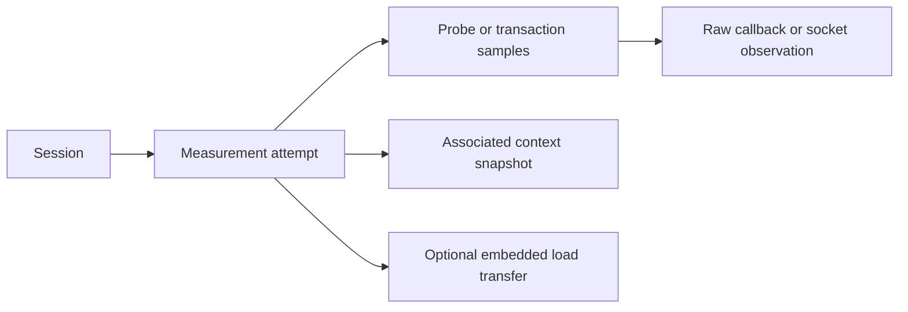

# Understanding our measurements

Start with the six focused CSVs, then use the raw data to investigate a specific observation. The existing wide CSVs mix metadata, summaries, different probe types and nested records; **84 columns do not mean 84 independent network measurements**.

The result of this audit is that our current libraries can collect basic network performance and some useful per-probe evidence. The custom engine adds original error-queue fields, socket timing and handset TCP kernel telemetry. Neither implementation captures all network packets or explains congestion during a transfer. See the [requirements and evidence comparison](comparison.md).

## Generate the readable views on your Mac

Use Node **22.13 or newer** with TypeScript stripping support (validated here on Node 26.5). From the repository root:

```sh
npm run measurements:analyze -- --input /path/to/session.json --out /path/to/new-analysis-directory
```

The input is **Export JSON** from the phone, or the `session.json` in its CSV bundle. Locally saved `source-session.json` files have the same shape. The command reads saved data; it runs no probes and contacts no servers. Choose a fresh output directory: existing output files are never overwritten.

| Output | Each row means | Start by reading |
| --- | --- | --- |
| `icmp.csv` | One echo probe, including timeouts | `sequence`, `rttMs`, `outcome`, `payloadBytes`, actual header fields |
| `tcp.csv` | One connection attempt | `connectDurationMs`, `timingScope`, `kernelRttMs`, window and retransmission fields |
| `traceroute.csv` | One probe at an outgoing hop limit | `hop`, `sequence`, `responderAddress`, `rttMs`, `outcome`, `icmpType`, `icmpCode` |
| `udp.csv` | One echo probe | `sequence`, `outcome`, `rttMs`, `payloadBytes` |
| `http.csv` | One HTTP measurement; loaded tests include the embedded transfer summary | `httpLatencyMs`, `throughputMbps`, `transferDurationMs`, baseline/loaded medians |
| `http-latency-samples.csv` | One HTTP transaction before or during a load | `sampleGroup`, `sequence`, `httpLatencyMs` |
| `report.md` | Human-readable audit | Findings, availability counts and interpretation limits |
| `sanity-checks.json` | Machine-readable audit | Each finding's severity, code and source JSON pointer |
| `column-dictionary.md` | Complete data dictionary | Meaning, datatype, units, source, formula and blank semantics |

The same dictionary is [available in the repository](columns.md). Edit its [machine-readable source](../../scripts/measurements/columns.json) and run `npm run measurements:docs` to regenerate documentation. The tool exits 0 when checks find no errors, 2 when analysis files were written but data errors were found, and 1 for invalid input/usage or output conflicts. Warnings and unavailable checks are not failed experiments.

## Understand rows before comparing columns

- A `measurements.csv` row is **one saved attempt**. An ICMP burst contains ten probes; a traceroute contains probes across many hops; a loaded test contains baseline transactions, transfer details, and during-transfer transactions.
- A `samples.csv` row is **one recorded sample**. The `sampleGroup` identifies ordinary probes, baseline transactions, traceroute observations, or reference callbacks. HTTP samples and SDK callbacks are not individual network packets.
- `events.csv` rows describe lifecycle/scheduling events. A completed session with late probes is different from an exactly periodic experiment.
- `network-context.csv` rows are context snapshots. `networkSnapshotId` joins a measurement to one snapshot; its sample rows reuse that context. Repetition does not increase the number of Wi-Fi or battery observations.
- `sessionId` identifies the session, `measurementId` joins samples to the parent `id`. Within a measurement use `sampleGroup` plus sequence, and hop for traceroute. Callback arrival order can differ from sequence order.
- Every focused row has a `recordPath` JSON pointer into the original input, such as `/measurements/0/details/samples/0`. It is the direct route back to evidence; identifiers and source records are not rewritten.



## Four times that must not be mixed

| Quantity | What it measures | Main limitation |
| --- | --- | --- |
| ICMP RTT | Echo request to matched echo response | Reply filtering and collector timing affect interpretation. |
| TCP connection time | Completion of a socket connection | Library time includes DNS/dispatch/callback overhead; native time has a narrower scope. Not SYN-only RTT. |
| Kernel TCP RTT | Kernel's smoothed estimate on a particular TCP socket | A short connection snapshot, not a separate RTT for every packet. |
| HTTP latency | Full timed HTTP transaction | Can include connection setup, server work, body transfer and application scheduling. |

For loaded tests, `httpLatencyMs` in `http.csv` is the median of during-transfer samples. `transferDurationMs` is the embedded transfer's duration, not the outer loaded-test duration, which can include baseline work and preparation. HTTP throughput is `8 × transferredBytes / (durationMs × 1000)` in decimal Mbit/s. **50 MiB = 52,428,800 bytes**, not 50,000,000 bytes. Byte counts exclude some or all protocol overhead; they are not carrier billing totals.

The existing `successiveDifferenceMs` is mean absolute RTT difference over adjacent successful sequence values. Failed samples break adjacency. It is not one-way jitter, RFC 3550 interarrival jitter, or a standard deviation. Median/p95 use finite, nonnegative samples; p95 uses nearest rank. See the exact [statistics implementation](../../src/measurements/statistics.ts).

Wall-clock timestamps describe scheduled/start/observation time depending on the field. Monotonic timestamps describe elapsed-time measurement within one device clock domain. Kernel realtime receive timestamps belong to another domain. Never subtract realtime receive nanoseconds from monotonic send nanoseconds. Nanosecond strings must remain text, including in spreadsheets; timestamp precision alone does not establish timing accuracy.

## Missing values, outcomes and provenance

A blank is not zero. It can mean the field does not apply, the producer cannot expose it, the observation failed, the field was not retained historically, or the CSV projection omitted an existing raw value. For example, native ICMP `probeBytes` is blank in the old sample projection while `packet.payloadBytes` is 64. The focused view recovers that value and records `payloadSizeSource`.

`success` is method specific. A burst can succeed with some missing replies; traceroute success requires arrival. A router's Time Exceeded response is useful traceroute evidence, not a failure of the traceroute. In icmpenguin rc.3, `HostUnreachable` cannot be interpreted as the original ICMP type. The original error type is not exposed correctly by that pinned library path. The report flags this ambiguity rather than inventing type/code values.

The library smoke run also predates a metadata fix: ICMP `responderAddress` repeated the resolved target, although the library did not expose the actual source address. Focused ICMP views leave that field blank and mark `addressEvidence=unavailable_library_target_only`. The raw record remains unchanged. Actual returned ICMP header/payload bytes are still useful evidence.

`library`/`libraryVersion` name what was recorded at collection. HTTP may have no such metadata: its `method` identifies the implementation, and dependencies are documented in the comparison. A thin Kotlin adapter exposes a library's results and lifecycle; it does not mean we replaced the library with our own measurement engine. The baseline C++ code, in contrast, creates sockets, collects Linux metadata and implements probe behavior.

## What the raw records contain

| Record | Available evidence | What it is not |
| --- | --- | --- |
| ICMP `receivedHex` | Received ICMP message, including echo header and payload, under its explicit scope | Complete outer IP packet, or proof that every outgoing header was captured |
| Native `sendBufferHex` | Buffer handed to the socket; ICMP identifier/checksum may subsequently be changed by the kernel | A capture of final outgoing wire bytes |
| Native trace error queue | Error origin/type/code, offender and any quoted original payload; raw ancillary bytes | Entire outer ICMP error packet or complete IP header |
| UDP callback/payload data | Application datagram bytes and available sender metadata | IP/UDP headers or hardware timestamps |
| Native `tcpInfoBefore/After` | Supported parsed kernel state and ABI-dependent raw struct bytes | TCP segments, ACK sequences, or HTTP-socket telemetry |
| Library `raw.callbacks` | Supplied callback fields and application observation times | Undisclosed SDK internals or kernel timestamps |

`packetRawJson` repeats the packet object. `rawSampleJson`/`rawRecordJson` preserve unflattened data and future fields; they are not additional independent measurements. `packets.jsonl` groups retained observations under their probe; nested `response` may repeat a selected entry in `observations`. Do not count both as different packets. `library-callbacks.jsonl` includes request metadata rows as well as callbacks, so its line count is not a packet count.

Hex uses two characters per retained byte. Base64 is another byte encoding, not compression. Respect `receivedScope`, `sendBufferScope`, truncation indicators, `droppedObservations` and `droppedCallbacks`. A native error response can have `receivedSocketBytes=0` with useful error metadata. An empty hex string becomes an ambiguous blank in CSV; consult JSON to distinguish an empty buffer from an absent one.

For context, Wi-Fi `signalStrength` is a **0–100 scale**, not dBm or satellite signal power ([NetInfo documentation](https://github.com/react-native-netinfo/react-native-netinfo)). Battery percentage comes from device-info; public IP/ASN come from optional server context, not packet capture. Neither identifies the satellite or its handovers.

## Sanity checks and their limits

The analyzer checks identifiers/joins, normalized types and ranges, sample identities, compatible-clock ordering, retained buffer lengths and ICMP header decoding, complete-burst counts, statistics, loss denominators, and transfer arithmetic. It separately reports historical ambiguity, export mapping gaps, dropped/truncated observations, missing kernel telemetry and unsuccessful UDP echoes. Legacy CSV headers are checked against the dictionary.

Errors identify inconsistent data or calculations. Warnings identify interpretation hazards. Unavailable checks mean necessary evidence was absent. A clean report does not prove the measured path, collector accuracy, RF conditions, or long-run reliability. Loss is inferred from missing matching replies, not observed at the physical link. Reference tests remain in the original exports but are outside the six focused views; an unrun feature is not validated by this audit.

Read [annotated real examples](examples.md), the [TCP_INFO appendix](tcp-info.md), and the [audit comparison](comparison.md) for the decision about native additions.
