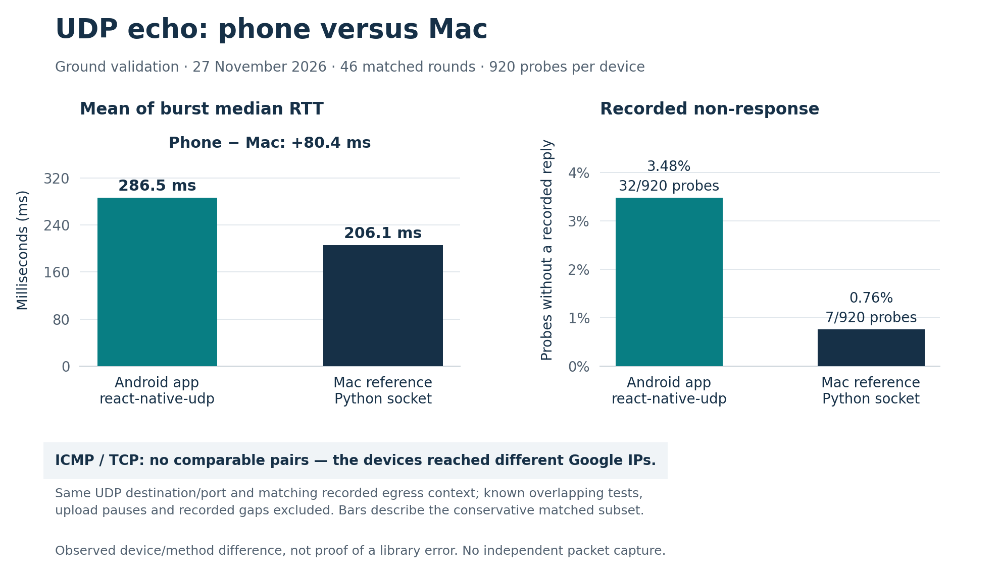

# Phone and Mac ground comparison — 27 November 2026

Analysed on 28 November 2026. This is a **ground test**, not flight validation. It compares an Android phone running `paper-core-v1` with a macOS computer running the light ICMP/UDP/TCP reference harness on the same Wi-Fi. The computer is an independent implementation on a different device, not packet-level ground truth or a Linux experiment.



## Collection and delivery

All times below are **Dubai time (UTC+04:00)**.

| Evidence | Interval or result |
| --- | --- |
| Phone trip | 27 November, 19:06:34.761–22:21:54.715; about 3 h 15 min |
| Mac reference | 27 November, 19:10:20.807–22:10:20.810; three hours, entirely within the phone trip |
| Phone delivery | 14/14 segments reconciled; 4,209/4,209 expected record versions received; zero missing or unexpected versions |
| Phone measurements | 726 parent measurement records, including 15 failed records |
| Final segment reconciliation | 22:47:28.298, about **25.6 minutes after Stop** |
| Mac evidence | 540 parent measurements: 180 rounds each of ICMP, UDP and TCP; no failed parent rounds or recorded collector gaps |
| Mac integrity | All 570 evidence files verified against the SHA-256 manifest; zero baseline sanity errors or warnings |

The server receipt audit checks expected record IDs and versions. It does not independently establish that every packet the phone attempted was recorded, or compare phone-local acknowledgement state. Likewise, a successful burst can contain individual timeouts. **Finished collection and finished upload are separate states.** Eventual reconciliation does not mean the post-Stop upload was timely.

## How the comparison was made

1. Restrict observations to the shared three-hour interval. Match starts one to one, using the nearest eligible reference attempt within **45 seconds**.
2. Require the same protocol, verified destination IP and, for UDP/TCP, port. Exclude unknown/mixed destinations, unusable timing, unsuccessful rounds and known mismatched observed egress IP/ASN context.
3. The broader cohort excludes Mac observations overlapping phone CDN, M-Lab or controlled-transfer activity. The **conservative subset** additionally excludes known traceroute, resolver-discovery, upload-pause and recorded-gap overlap.
4. Compare each UDP burst's median of received-probe RTTs. The graph reports the **arithmetic mean of those burst medians**, giving each matched round equal weight. It is not the mean or median of all individual replies pooled together.
5. Calculate recorded non-response as `100 × timeouts / recorded probes` across the same matched rounds. This describes observations at the application layer, not verified on-wire packet loss.

The observed public egress address sets matched overall, with three addresses observed on each device. Many candidate pairs nevertheless had different per-observation egress context and were excluded. Context is sampled periodically; these exclusions are not proof that the devices used different Wi-Fi. The recorded UDP destination and port matched. Exact addresses, account information, trip IDs and raw phone records are omitted from the public fixture.

## Matched UDP results

| Cohort | Matched rounds | Phone mean burst median RTT | Mac mean burst median RTT | Mean paired difference, phone − Mac | Phone non-response | Mac non-response |
| --- | ---: | ---: | ---: | ---: | ---: | ---: |
| Broader eligible cohort | 59 | 286.6 ms | 206.7 ms | +79.9 ms | 41/1,180 (3.47%) | 9/1,180 (0.76%) |
| Conservative subset, graphed | **46** | **286.5 ms** | **206.1 ms** | **+80.4 ms** | **32/920 (3.48%)** | **7/920 (0.76%)** |

The conservative subset's median paired difference was **+82.5 ms**. It is calculated from the individual paired differences, not by subtracting the two separate medians. The typical absolute start separation was **5.056 seconds** (median), with a maximum of **36.075 seconds**. The intended thirty-second stagger was not achieved; matching uses recorded attempt times instead of the approximate initial phone anchor.

The UDP excess remains after the additional exclusions. It warrants investigation, but **does not identify a library defect**. The phone measures application send-call to JavaScript receive-callback time; the Python reference uses socket send/receive timing. Wi-Fi power saving, device and OS scheduling, callback delivery and network variation can all contribute. No predeclared accuracy tolerance or independent packet capture was available, and the phone clock offset was not calibrated. The Mac passed its initial SNTP check (reported offset 0.386 seconds); this is not evidence that either clock stayed aligned throughout the run. The plot has no uncertainty bars and is descriptive, not a significance test.

## Why ICMP and TCP are not plotted as agreement results

There were **zero eligible same-destination pairs** for both protocols. Although both devices requested `google.com`, the recorded destination IP sets were disjoint. A difference between those timings would mix destination/path differences with implementation differences. Unavailable agreement is not a zero timing difference or a failed ICMP/TCP measurement.

## What the complete phone trip recorded

These are **whole-trip parent record outcomes**, not counts from the shorter matched comparison subset. They should not be interpreted as independent validation of accuracy.

| Measurement | Successful / attempted parent records | Interpretation |
| --- | ---: | --- |
| ICMP burst | 193/193 | A successful burst can still contain individual non-replies |
| UDP burst | 194/194 | Same qualification: burst success does not imply every datagram replied |
| TCP connection | 194/194 | Connection callbacks completed |
| Traceroute | 52/65 | Thirteen records reported a timeout/non-reaching outcome |
| CDN object fetch | 63/65 | Two network errors |
| Resolver discovery | 13/13 | Request success is separate from availability of every resolver field |
| M-Lab download | 1/1 | Completed result: 132.3 Mbps |
| M-Lab upload | 1/1 | Completed result: 88.4 Mbps |

The 15 failed parent records are the thirteen traceroutes plus two CDN fetches. Neither a non-reaching traceroute nor an application timeout alone proves a collector bug.

## Next validation

- **Pin identical IPv4 destinations for ICMP and TCP on both devices**, retaining protocol and port checks. Repeat before drawing an agreement conclusion for those protocols.
- **Isolate UDP timing** with a reference on the same phone or a controlled Wi-Fi gateway packet capture. Repeat with the screen on/off and documented power settings. Packet capture can distinguish actual network time from application callback delay.
- **Measure upload recovery separately.** Confirm prompt post-Stop retry and make pending/completed upload state visible alongside collection state; this run ultimately uploaded everything but took 25.6 minutes after Stop.

Real-flight detection accuracy, unplugged endurance and exact packet timing remain unvalidated by this ground run.

## Reproduce the figure

The committed [aggregate fixture](data/paired-validation-2026-11-27.json) contains only the reviewed summary fields. Raw phone evidence stayed on the server; only aggregates were returned for this analysis. Original Mac evidence and the private analysis manifest remain local under ignored `build/` directories. The figure generator reads the public fixture, computes percentages and checks count/difference consistency; it never reads participant exports.

```sh
python3 -m venv build/validation-plot-venv
build/validation-plot-venv/bin/python -m pip install -r paper/requirements.txt
build/validation-plot-venv/bin/python scripts/baseline/plot_comparison.py \
  --input docs/skymeasure/data/paired-validation-2026-11-27.json \
  --out docs/skymeasure/figures/paired-validation-2026-11-27
```

Outputs: [PNG](figures/paired-validation-2026-11-27.png) for the README and [SVG](figures/paired-validation-2026-11-27.svg) for scalable reuse. This dated result is separate from the [progress paper's frozen evidence](../../paper/README.md) and does not revise its historical figures. For new runs and the matching/exclusion workflow, see the [baseline validation guide](../measurements/validation.md).
